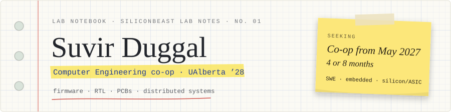

<picture>
  <source media="(prefers-color-scheme: dark)" srcset="assets/header-dark.svg">
  
</picture>

  <a href="https://suvir.framer.website"><b>Portfolio</b></a> ·
  <a href="https://suvir.framer.website/resume"><b>Résumé (PDF)</b></a> ·
  <a href="https://www.linkedin.com/in/suvirduggal">LinkedIn</a> ·
  <a href="mailto:suvir1@ualberta.ca">suvir1@ualberta.ca</a> ·
  <a href="https://devpost.com/suvir1">Devpost</a>

### Abstract

Computer Engineering co-op student at the **University of Alberta** (BSc, May 2028). I like work that crosses the hardware/software line: RTL and silicon, firmware on real boards, and the distributed systems that collect their data.
**Looking for a 4- or 8-month co-op from May 2027** in software, embedded, silicon/ASIC or systems. Based in Edmonton, AB; open to relocation.

### Experience

- **Software Engineer Intern, TELUS** · Jan – Aug 2026 
  Built a Go gRPC/gNMI streaming telemetry pipeline for an arm64 OpenWrt fleet: **35+ metrics, latency cut from 30+ minutes to 5 seconds**. Added 6,500+ property-based API tests. Won the Students’ Union Award for Outstanding Innovation.
- **Program Instructor and Teaching Assistant, Faculty of Engineering, UAlberta** · 2025 – now 
  Cut onboarding for 450+ students from 4 hours to 30 seconds with a Python bot.
- **Undergraduate Research Assistant, UAlberta** · Oct 2024 – Jan 2025 
  Interpretable fuzzy neural network in TensorFlow, 90% accuracy over 3 classes. Dean’s Research Award.

### Lab sheets

| Project | What it is | Built with |
|---|---|---|
| **Silica** · *in progress* | ASIC for the Jane Street Tapeout contest: a UART/SPI/I2C/CAN protocol engine with an embedded FPGA, so it can learn new protocols after fabrication | Verilog, cocotb, Yosys, LibreLane |
| [**RISC-V SoC + GPU**](https://suvir.framer.website/projects/risc-v-soc-gpu) · *in progress* | RV32I core with a pipelined Mandelbrot accelerator squeezed into 20 hardware multipliers, plus HDMI video and PWM audio, on a Tang Nano 9K | VHDL, Yosys, FPGA |
| **InSite** · *NatHacks 2026 winner* | Worker safety vest: 4 spine IMUs plus air-quality, noise and heart-rate sensors on an ESP32-S3, with the spine mirrored live in 3D | C++, FreeRTOS, BLE, FastAPI, Three.js |
| [**SignalScout**](https://suvir.framer.website/projects/signalscout) · *in progress* | Pocket device that replaces 3 field instruments: two custom PCBs and a 3D-printed enclosure, designed end to end. Autodesk University 2027 hardware recipient | KiCad, Autodesk Fusion, ESP32-S3, Arduino UNO Q, LoRa |
| [**Wingman**](https://suvir.framer.website/projects/wingman) | Driver assist that keeps its safety alerts alive if the AI crashes: Jetson GPU perception, i.MX RT1170 safety MCU, failsafe within 100 ms | CUDA, C++, Zephyr RTOS |
| [**RF Telemetry Board**](https://suvir.framer.website/projects/rf-telemetry-board) | EcoCar RF PCB redesigned in KiCad, with STM32 firmware streaming live speed, battery and GPS to the pit | C, STM32, KiCad |
| [**BioTherma-AI**](https://suvir.framer.website/projects/biotherma-ai) | Edge-AI monitor that spots a bio-digester going wrong from temperature and humidity alone | C++, Python, Arduino UNO Q |

### Toolbox

**Languages** C · C++ · Python · Go · Verilog / SystemVerilog · VHDL · CUDA · SQL 
**Hardware & EDA** KiCad · Vivado · Yosys · cocotb · FPGA · STM32 · ESP32 · oscilloscope · logic analyzer 
**Software** gRPC · Docker · Linux · AWS · GCP · Grafana · CI/CD · Claude Code

### Awards

NatHacks 2026 winner (InSite) · Autodesk University 2027 hardware recipient (SignalScout) · UASU Outstanding Innovation Award 2026 · Dean’s Research Award · HackEd Beta 1st place 2024

The hand-drawn version of this page, with diagrams and the numbers behind each project: <a href="https://suvir.framer.website">suvir.framer.website</a>
