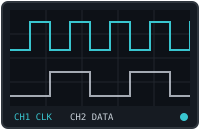
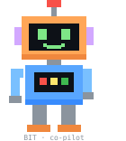
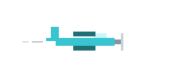
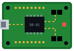

<div align="center">


<br/>


</div>

<br/>

## `// character_sheet`



```
╔══════════════════════════════════════════════════════════╗
║  NAME     Suvir Duggal                                   ║
║  CLASS    Silicon Mage  (Hardware · Embedded · Software) ║
║  LEVEL    4  ── Computer Engineering Co-op @ UAlberta    ║
║  GUILD    ex-TELUS SWE intern  ── gRPC/gNMI telemetry    ║
║  QUEST    Summer 2027 semiconductor / SWE internship     ║
║  SPAWN    Edmonton, AB  ── open to relocate              ║
╠══════════════════════════════════════════════════════════╣
║  XP  [██████████████████████████████████░░░░░░] → 2028   ║
╚══════════════════════════════════════════════════════════╝
```

<br clear="right"/>

## `// stats`



```
CPU ARCHITECTURE     ██████████████████░░  RV32I core
RTL DESIGN           ██████████████████░░  Mandelbrot GPU
EMBEDDED SYSTEMS     ███████████████████░  STM32 · Jetson
DISTRIBUTED SYSTEMS  ████████████████░░░░  fleet telemetry
CI/CD                ███████████████░░░░░  fleet deploys
AUTOMATED TESTING    █████████████████░░░  6,500+ fuzz tests
```

<br clear="right"/>

## `// skill_tree`



```
                           ◆ SUVIR.EXE ◆
                ● unlocked     ──▶ unlock path

├─◆ LANGUAGES
│   ├─● C ──▶ ● C++ ──▶ ● CUDA
│   ├─● VHDL ──▶ ● Verilog
│   ├─● Python ──▶ ● Go ──▶ ● Java
│   └─● SQL ──▶ ● MATLAB
│
├─◆ SOFTWARE
│   ├─● Git ──▶ ● Docker ──▶ ● gRPC ──▶ ● REST APIs
│   ├─● InfluxDB ──▶ ● Grafana
│   ├─● GCP ──▶ ● AWS
│   ├─● Agile ──▶ ● Jira ──▶ ● Confluence
│   └─● Claude Code
│
└─◆ HARDWARE / EDA
    ├─● KiCad ──▶ ● LTSpice ──▶ ● Cadence
    ├─● Vivado ──▶ ● FPGA (Gowin · Xilinx)
    └─● STM32 ──▶ ● Raspberry Pi ──▶ ● Nvidia Jetson
```

<br clear="right"/>

## `// quest_log`

| | Quest | What it is | Loot |
|---|---|---|---|
| 🟡 | **RISC-V SoC + GPU** | RV32I in VHDL on a Tang Nano 9K, fixed-point Mandelbrot accelerator, HDMI + PWM audio | ASIC via Tiny Tapeout |
| 🟡 | **RF Telemetry Board** | EcoCar RF PCB in KiCad + STM32 firmware streaming speed, battery, GPS | F1-style pit dashboard |
| 🟡 | **Wingman** | Driver assist: Jetson TX2 CUDA perception + i.MX RT1170 safety MCU | CUDA Kalman tracker bank |
| 🟡 | **BioTherma-AI** | Bio-digester monitor on Arduino UNO Q | Hackster contest entry |
| 🟢 | **TELUS Co-op** | Go gRPC/gNMI telemetry pipeline for an arm64 OpenWrt fleet | latency 30 min → 5 s |
| 🟢 | **Research Assistant** | Fuzzy neural network in TensorFlow + scikit-learn | research poster |
| 🟢 | **EyesPi** | Raspberry Pi 5 facial-recognition security system | CV + embedded |

<sub>🟡 in progress · 🟢 complete — <!-- TODO: link each quest name to its repo --></sub>

## `// achievements`


```
[🏆] Outstanding Innovation Award ...... UASU, 2026
[🔬] Dean's Research Award ............. UAlberta research
[🎓] Teaching Assistant ................ Faculty of Engineering
[🧑‍🏫] Instructor ........................ Bridge2Engg
[🔒] First Silicon ..................... LOCKED — chips pending
```

<br clear="right"/>

## `// battle_record`

<div align="center">


<br/><br/>


</div>

## `// side_quests`



```
> flight simulators  ✈  logging cockpit hours
                        when not in Vivado
```

<br clear="right"/>



## `// multiplayer`



<div align="center">

<a href="mailto:suvir1@ualberta.ca"></a>
<a href="https://www.linkedin.com/in/suvirduggal"></a>
<a href="https://suvir.framer.website"></a>

<sub>`> INSERT COIN TO CONTINUE`</sub>

</div>

<br clear="right"/>
